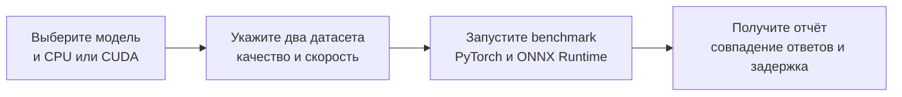

# HiveTrace-AutoTune-Guardrails
Найти ускорения guardrail-моделей без скрытого падения качества на редких атаках, обфускации и неанглийских текстах в продукте

## Скелет CLI

Минимальная версия Python — **3.10**. Для разработки по умолчанию используется
Python 3.12 из `.python-version`. Зависимости и команды запуска управляются через
[uv](https://docs.astral.sh/uv/). GPU-бэкенды могут иметь дополнительные
ограничения по Python, CUDA и операционной системе.

```bash
uv sync --extra hub --extra datasets --extra inference --extra inference-cpu
uv run --no-sync ruff check .
uv run --no-sync ruff format --check .
uv run --no-sync mypy
uv run --no-sync pytest
```

Для локального каталога модели достаточно базовой установки.
Дополнение `hub` позволяет читать метаданные Hugging Face.

```bash
uv sync --extra hub
uv run --no-sync guardrail-tuner inspect KoalaAI/Text-Moderation
uv run --no-sync guardrail-tuner plan KoalaAI/Text-Moderation
uv run --no-sync guardrail-tuner plan ./local-checkpoint
```

`inspect` читает `config.json`. Для Hugging Face можно указать `--revision`.
На этом этапе CLI загружает только конфиг.

`plan` предлагает проверки по типу архитектуры из конфига. Среди кандидатов
есть vLLM, ONNX Runtime, `torch.compile` и TensorRT через ONNX. Для
`torch.compile` план предусматривает сравнение с PyTorch eager, а для TensorRT
сначала нужно проверить экспорт и запуск на CUDA. Статус
`unverified` означает, что совместимость нужно подтвердить запуском.
`needs_inference_contract` означает, что CLI пока нужен способ подготовить
вход и сравнить выход модели с эталоном.

Результаты `plan` описывают кандидатов. Команда `benchmark` выполняет
сравнение PyTorch и ONNX Runtime для sequence classification.

## Как работает CLI



Команда `benchmark` загружает модель и датасеты, готовит ONNX и сравнивает
результаты с PyTorch на наборе качества. Затем она замеряет оба варианта на
наборе скорости и выводит JSON-отчёт. При расхождении сверх допуска команда
возвращает код 1.

Перед запуском можно отдельно изучить модель через `inspect`, посмотреть
непроверенные варианты через `plan` и проверить загрузку наборов через
`datasets`. Пример полного прогона находится в разделе
[«Первый прогон классификатора»](#первый-прогон-классификатора).

Сейчас `benchmark` поддерживает sequence classification и последовательные
запросы с batch size 1. Он сравнивает выходы с PyTorch; метрики по разметке и
автоматический подбор конфигурации ещё не реализованы.

## Датасеты качества и скорости

Установите поддержку датасетов и авторизуйтесь в Hugging Face через
`hf auth login` или переменную окружения `HF_TOKEN`. Токен должен иметь
доступ на чтение приватных наборов.

```bash
uv sync --extra datasets
uv run --no-sync guardrail-tuner datasets \
  --quality-hf my-org/quality --quality-split test --quality-revision main \
  --performance-hf my-org/performance --performance-split test --performance-revision main
```

Вместо каждого HF ID можно независимо передать `--quality-file` или
`--performance-file` с путём к JSON, JSONL, CSV или Parquet. Например:

```bash
uv run --no-sync guardrail-tuner datasets \
  --quality-hf my-org/quality --quality-split test \
  --performance-file ./performance.jsonl
```

Для HF также доступны `--quality-config` и `--performance-config` для выбора
конфигурации датасета. По умолчанию используется split `train`. Команда
загружает данные в стандартный кэш Hugging Face и выводит количество строк,
названия колонок и точный commit SHA. Для локальных файлов выводится SHA-256.
Сами записи в отчёт не попадают.

ID и схема приватных наборов задаются при запуске. Команда `datasets`
проверяет загрузку источников, а `benchmark` использует их для сравнения
результатов и замера скорости.

Правила разработки и формат коммитов описаны в [CONTRIBUTING.md](CONTRIBUTING.md).

## Первый прогон классификатора

Команда `benchmark` поддерживает модели Transformers для sequence classification.
Два датасета должны содержать строковую колонку с текстом. Для Hugging Face
наборов вместо файлов доступны те же параметры `--quality-hf`,
`--performance-hf`, `--*-split`, `--*-revision` и `--*-config`, что и у
команды `datasets`.

```bash
uv sync --extra inference --extra inference-cpu
uv run --no-sync guardrail-tuner benchmark KoalaAI/Text-Moderation \
  --device cpu --output-mode multilabel --threshold 0.5 \
  --quality-file ./quality.jsonl --performance-file ./speed.jsonl
```

Для CUDA установите совместимые драйвер и библиотеки CUDA/cuDNN, затем выберите
GPU-версию ONNX Runtime:

```bash
uv sync --extra inference --extra inference-cuda
uv run --no-sync guardrail-tuner benchmark MODEL_ID --device cuda \
  --output-mode multiclass --quality-file ./quality.jsonl --performance-file ./speed.jsonl
```

CPU и CUDA extras взаимоисключающие. `--no-sync` сохраняет выбранные extras при
запуске. Для CUDA версии PyTorch и ONNX Runtime должны быть совместимы по CUDA
и cuDNN. CLI проверяет доступность CUDA и активного ONNX Runtime provider.
ONNX Runtime может размещать отдельные неподдерживаемые операции на CPU.

Укажите `--output-mode multiclass` для softmax и argmax,
`--output-mode multilabel` для sigmoid и общего порога `--threshold`, либо
`--output-mode logits` для сравнения только логитов. Выбор зависит от модели.
`--max-logit-error` задаёт допустимое максимальное абсолютное отклонение
(по умолчанию 0.001). При превышении или несовпадении решений команда
возвращает код 1 и сохраняет результаты в JSON на stdout. Для анализа разметки
и отдельных порогов классов нужен отдельный контракт данных.

Замер последовательный, с batch size 1 и без имитации очереди. Он включает
токенизацию, инференс и перенос выхода на CPU. Число запросов равно количеству
строк датасета скорости, поэтому для устойчивого p95/p99 нужен достаточно
большой набор. Экспорт ONNX и загрузка моделей выполняются до замера.

Имя колонки по умолчанию — `text`. Общую замену задаёт `--text-column`,
а разные колонки для наборов — `--quality-text-column` и
`--performance-text-column`.
