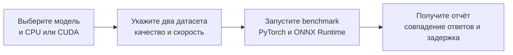

# HiveTrace-AutoTune-Guardrails
Найти ускорения guardrail-моделей без скрытого падения качества на редких атаках, обфускации и неанглийских текстах в продукте

## Установка CLI

Минимальная версия Python — **3.10**. Из каталога репозитория установите CLI
через [uv](https://docs.astral.sh/uv/) и запускайте его напрямую.

Для CPU:

```bash
uv tool install '.[inference,inference-cpu]'
guardrail-tuner --help
```

Для NVIDIA CUDA:

```bash
uv tool install '.[inference,inference-cuda]'
guardrail-tuner --help
```

CPU и CUDA варианты устанавливаются отдельно. Для смены варианта используйте
`uv tool install --force` с нужными extras. Если команда после установки не
найдена, выполните `uv tool update-shell` и перезапустите терминал. Установка
инструмента разрешает версии зависимостей отдельно от проектного `uv.lock`.

```bash
guardrail-tuner inspect KoalaAI/Text-Moderation
guardrail-tuner plan KoalaAI/Text-Moderation
guardrail-tuner plan ./local-checkpoint
```

Для разработки используйте команды и выбор окружения из
[CONTRIBUTING.md](CONTRIBUTING.md).

`inspect` читает `config.json`. Для Hugging Face можно указать `--revision`.
На этом этапе CLI загружает только конфиг.

`plan` предлагает проверки по типу архитектуры из конфига. Среди кандидатов
есть vLLM, ONNX Runtime, `torch.compile` и TensorRT через ONNX. Для
`torch.compile` план предусматривает сравнение с PyTorch eager, а для TensorRT
сначала нужно проверить экспорт и запуск на CUDA. Статус
`unverified` означает, что совместимость нужно подтвердить запуском.
`needs_inference_contract` означает, что CLI пока нужен способ подготовить
вход и сравнить выход модели с эталоном.

Результаты `plan` описывают кандидатов. Команды `benchmark` и `optimize`
сравнивают PyTorch и ONNX Runtime для sequence classification.

## Как работает CLI



Команда `benchmark` загружает модель и датасеты, готовит ONNX и сравнивает
результаты с PyTorch на наборе качества. Затем она замеряет оба варианта на
наборе скорости и выводит JSON-отчёт. При расхождении сверх допуска команда
возвращает код 1.

Перед запуском можно отдельно изучить модель через `inspect`, посмотреть
непроверенные варианты через `plan` и проверить загрузку наборов через
`datasets`. Пример полного прогона находится в разделе
[«Первый прогон классификатора»](#первый-прогон-классификатора).

Сейчас `benchmark` поддерживает sequence classification и последовательные
запросы с batch size 1. Он сравнивает выходы с PyTorch и может дополнительно
оценить совпадение с размеченными данными.

## Датасеты качества и скорости

По умолчанию для скорости используется преднастроенный `role-v4` —
[корпус из 12 000 записей](https://huggingface.co/datasets/vXofi/guardrails-speed-en-ru/tree/7324b8823ded971c05076e0c7f4ace5d9b867863)
с закреплённой ревизией. CLI загружает `manifest.json` и `corpus.jsonl`,
проверяет их SHA-256 и число записей. При первом запуске нужен доступ к Hugging
Face и достаточно места в кэше. Датасет качества по-прежнему задаётся отдельно.

Исходные `messages` сохраняются в записях; для текстового интерфейса CLI создаёт
поле `text` из последнего сообщения (user или assistant). Это общий способ
подготовки, а не нативный prompt конкретной модели. Опубликованные в U1 индексы
и модельные бакеты здесь не используются: CLI строит свои по входному тексту.
Поэтому такой прогон не воспроизводит методику или числа U1 и не измеряет safety.
Преобразование и ревизия записываются в отчёт.

Свой набор скорости можно указать через `--performance-hf` или
`--performance-file`; они заменяют пресет. `--performance-preset role-v4`
выбирает его явно. Для `tune-model` и `benchmark` разные колонки качества и
скорости задаются через `--quality-text-column` и `--performance-text-column`.

Установите поддержку датасетов и авторизуйтесь в Hugging Face через
`hf auth login` или переменную окружения `HF_TOKEN`. Токен должен иметь
доступ на чтение приватных наборов.

```bash
guardrail-tuner datasets \
  --quality-hf my-org/quality --quality-split test --quality-revision main \
  --performance-hf my-org/performance --performance-split test --performance-revision main
```

Вместо каждого HF ID можно независимо передать `--quality-file` или
`--performance-file` с путём к JSON, JSONL, CSV или Parquet. Например:

```bash
guardrail-tuner datasets \
  --quality-hf my-org/quality --quality-split test \
  --performance-file ./performance.jsonl
```

Для HF также доступны `--quality-config` и `--performance-config` для выбора
конфигурации датасета. По умолчанию используется split `train`. Команда
загружает данные в стандартный кэш Hugging Face и выводит количество строк,
названия колонок и точный commit SHA. Для локальных файлов выводится SHA-256.
Сами записи в отчёт не попадают.

ID и схема приватных наборов задаются при запуске. Команда `datasets`
проверяет загрузку источников, а `benchmark` использует их для сравнения
результатов и замера скорости.

Правила разработки и формат коммитов описаны в [CONTRIBUTING.md](CONTRIBUTING.md).

## Первый прогон классификатора

Команда `benchmark` поддерживает модели Transformers для sequence classification.
Два датасета должны содержать строковую колонку с текстом. Для Hugging Face
наборов вместо файлов доступны те же параметры `--quality-hf`,
`--performance-hf`, `--*-split`, `--*-revision` и `--*-config`, что и у
команды `datasets`.

```bash
guardrail-tuner benchmark KoalaAI/Text-Moderation \
  --device cpu --output-mode multilabel --threshold 0.5 \
  --quality-file ./quality.jsonl --performance-file ./speed.jsonl
```

Для CUDA установите совместимые драйвер и библиотеки CUDA/cuDNN, затем выберите
GPU-версию ONNX Runtime:

```bash
guardrail-tuner benchmark MODEL_ID --device cuda \
  --output-mode multiclass --quality-file ./quality.jsonl --performance-file ./speed.jsonl
```

CPU и CUDA extras взаимоисключающие. Для CUDA версии PyTorch и ONNX Runtime
должны быть совместимы по CUDA
и cuDNN. CLI проверяет доступность CUDA и активного ONNX Runtime provider.
ONNX Runtime может размещать отдельные неподдерживаемые операции на CPU.

Укажите `--output-mode multiclass` для softmax и argmax,
`--output-mode multilabel` для sigmoid и общего порога `--threshold`, либо
`--output-mode logits` для сравнения только логитов. Выбор зависит от модели.
`--max-logit-error` задаёт допустимое максимальное абсолютное отклонение
(по умолчанию 0.001). При превышении или несовпадении решений команда
возвращает код 1 и выводит результаты в JSON на stdout. Для анализа по разметке
добавьте `--quality-label-column`, как описано ниже.

Замер последовательный, с batch size 1 и без имитации очереди. Он включает
токенизацию, инференс и перенос выхода на CPU. Число запросов равно количеству
строк датасета скорости, поэтому для устойчивого p95/p99 нужен достаточно
большой набор. Экспорт ONNX и загрузка моделей выполняются до замера.

Имя колонки по умолчанию — `text`. Общую замену задаёт `--text-column`,
а разные колонки для наборов — `--quality-text-column` и
`--performance-text-column`.

## Автоподбор конфигурации

```bash
guardrail-tuner optimize KoalaAI/Text-Moderation \
  --device cpu --output-mode multilabel --threshold 0.5 \
  --quality-file ./quality.jsonl --performance-file ./speed.jsonl \
  --output-dir ./results/run-1
```

Для CUDA выберите `--device cuda` и установите `inference-cuda` вместо
`inference-cpu`. Параметры датасетов и выходов совпадают с `benchmark`.
Каталог результатов должен быть пустым или отсутствовать.
Для проверки ONNX Runtime с TensorRT Execution Provider можно дополнительно
указать `--ort-provider tensorrt`; он должен быть доступен в установленном
ONNX Runtime и требует совместимого CUDA/TensorRT окружения. Включённый provider
не гарантирует, что все узлы исполняются в TensorRT: покрытие графа пока не
проверяется. Результат описывает ONNX Runtime с этим списком provider, а не
подтверждает полностью TensorRT-исполнение.

Команда проверяет уровни оптимизации графа ONNX Runtime `all` и `extended`.
На CPU также сравнивает число intra-op потоков 0 (авто) и 1. Каждый вариант
проверяется на датасете качества и измеряется на наборе скорости. Выбор ONNX
требует A/A-проверки двух экземпляров PyTorch и повторных измерений p99; если
данных недостаточно, остаётся PyTorch со статусом `preliminary`. CLI сохраняет
`config.yaml` с параметрами и `report.md` с результатами
всех кандидатов. Если ни один прогон не завершился, создаётся только отчёт,
а команда возвращает код 1.

Конфигурация предназначена для воспроизведения настроек. CLI пока не запускает
сервер из `config.yaml` и не сохраняет экспортированный ONNX. Это сравнение
одной последовательной нагрузки. Для режима `logits` совпадение решений и
вероятностей не проверяется.

## Проверка по разметке

Для `benchmark` и `optimize` можно указать `--quality-label-column label`.
В режиме `multiclass` значение колонки — целочисленный индекс класса из выходов
модели. В режиме `multilabel` — массив из 0 и 1 в порядке выходов модели.
Пример для двух выходов:

```json
{"text": "пример", "label": [0, 1]}
```

Отчёт содержит число точных совпадений с разметкой и TP, FP, TN и FN для
каждого индекса класса, отдельно для PyTorch и ONNX Runtime. Для `multilabel`
точное совпадение требует совпадения всех меток записи. В выборе конфигурации
по-прежнему используются совпадение решений с PyTorch и допуск на logits.
Разметка помогает оценить оба варианта, но сама по себе не меняет критерий отбора.

### Экспериментальные режимы: модель и прикладной путь

`tune-model` сравнивает PyTorch eager с `torch.compile` для текстового вызова
модели с выходом `logits`. Требуется архитектура, объявленная в `config.json` и
доступная в установленной версии Transformers. Команда не исполняет удалённый
код модели. Пока проверяются только `forward` и logits: генерация, cache,
прикладные решения, ONNX и TensorRT в этом режиме не проверяются. Совместимость
других архитектур, форматов входа и версий Transformers не гарантируется.
При выборе `torch_compile` конфигурация описывает способ повторного запуска;
скомпилированный артефакт не сохраняется, вызывающая программа должна сама
применить `torch.compile` к модели. Результат не подтверждает качество приложения.

```bash
guardrail-tuner tune-model org/model --device cpu \
  --quality-file quality.jsonl --performance-file speed.jsonl \
  --text-column text --output-dir model-results
```

`tune-model` группирует нагрузку по токеновой длине после ограничения
`--max-length`: границы по умолчанию — 128, 256, 512, 1024 и 2048 токенов;
размеры батча — 1, 2, 4 и 8. Их можно заменить, например,
`--buckets 64 128 256 --batch-sizes 1 4`. Значения должны быть строго
возрастающими; список батчей должен включать 1. Длины измеряются токенизатором
модели, количество усечённых входов отражается в отчёте. Для каждого бакета и
батча CLI проверяет доступность примеров качества, совпадение с одиночным
инференсом, A/A и A/B, затем показывает p99 и пропускную способность. Замеры
с недостаточным количеством запросов предварительные. При CUDA дополнительно
фиксируется пиковая память процесса для всех одновременно загруженных моделей.
Эти же параметры поддерживаются в `benchmark` и `optimize` для классификаторов
через ONNX Runtime. Кандидат не выбирается, если проверка batch size 1 в
каком-либо бакете недостаточна или не пройдена. Замеры не моделируют время
ожидания накопления батча в очереди.

`compare-app` проверяет две пользовательские программы без SDK. Обе команды
задаются JSON-массивами аргументов и запускаются без shell. По умолчанию CLI
запускает два независимых процесса эталона и один процесс кандидата. Каждый
читает строки JSON из stdin и для каждой записи сразу возвращает ровно один
JSON-объект с завершающим переводом строки в stdout, сбрасывая буфер (`flush`).
Запросы идут последовательно, следующая строка отправляется после ответа.
Процессы должны продолжать работу между запросами. Диагностику
следует отправлять в stderr; CLI не сохраняет её. Команды и сами записи не
сохраняются в отчёт. Не передавайте секреты через аргументы команды.
Все три процесса работают одновременно, поэтому каждый должен помещаться в
доступную память устройства.

Для замеров пакетного JSONL укажите `--batch-tokenizer org/tokenizer` и при
необходимости `--batch-tokenizer-revision`, `--batch-text-column`, `--buckets`
и `--batch-sizes`. Тогда процесс дополнительно должен принимать строки вида
`{"inputs":[{"text":"..."},{"text":"..."}]}` и возвращать
`{"outputs":[{"decision":"..."},{"decision":"..."}]}` в том же порядке.
CLI сравнивает пакетные результаты с одиночными перед замерами. Бакетизация
учитывает токены текстового поля с указанным токенизатором; системный промпт,
шаблон и усечение внутри приложения она автоматически учесть не может.

```bash
guardrail-tuner compare-app \
  --reference-command '["python", "classify.py", "--backend", "eager"]' \
  --candidate-command '["python", "classify.py", "--backend", "optimized"]' \
  --model org/model --model-revision COMMIT_SHA \
  --reference-runtime torch-eager --candidate-runtime torch-compile \
  --quality-file quality.jsonl --performance-file speed.jsonl \
  --exact-field safety_label --exact-field category \
  --numeric-field tier_probs.unsafe:0.001 --output-dir app-results
```

Приложение само отвечает за переключение backend, включая одинаковые модель,
ревизию, промпт и настройки обоих вызовов. CLI не может подтвердить эти данные
или автоматически внедрить оптимизированный runtime в сторонний процесс.
Идентификатор модели, ревизия и названия runtime записываются со слов пользователя;
версии зависимостей и настройки устройства внешних процессов CLI не определяет.
Нужно указать хотя бы одно поле сравнения; числовые поля задаются как
`путь.к.полю:абсолютный_допуск`. Кандидат не выбирается при расхождении полей.
По умолчанию замер включает обмен JSONL и не включает запуск процесса; прогрев
выполняется в тех же процессах до замера. `--process-mode fresh` сохраняет
прежний режим запуска на каждую запись: он включает запуск, а предварительные
вызовы не прогревают измеряемые процессы. Оба режима пишут
`config.yaml` и `report.md`; приватные датасеты на Hugging Face задаются через
`--quality-hf` и `--performance-hf` с обычной авторизацией Hugging Face.

Выбор кандидата в этих режимах требует успешной проверки результатов, не менее
100 записей производительности и трёх раундов с чередованием порядка запуска.
Разброс p99 эталона между раундами должен быть не больше 5%, а кандидат должен
быть быстрее эталона минимум на 5% в каждом раунде. Это консервативные эвристики,
а не гарантия статистической значимости. Оба экземпляра эталона дополнительно
проходят A/A-проверку выходов и p99 в каждом раунде:
различие p99 должно быть не больше 5%. Это не проверка на всех входах и не
заменяет анализ статистической мощности. При меньшем
наборе и нестабильном эталоне результат помечается `preliminary`, а безопасной
конфигурацией остаётся эталон. При расхождении результатов кандидат отклоняется.
`tune-model` использует два отдельных экземпляра модели в одном процессе; это
увеличивает потребление оперативной и видеопамяти. Для `compare-app` A/A
сравнивает два отдельных процесса и только выбранные пользователем поля.

### Проверка генерации и vLLM

`guardrail-tuner check-generation org/model --device cpu --quality-file quality.jsonl`
сравнивает последовательности и scores greedy-генерации с cache и без cache
на эталоне с вычислениями FP32. `--compile` дополнительно проверяет
скомпилированный `forward` с cache. Это не проверка формата прикладного ответа
или производительности.

`guardrail-tuner probe-vllm org/model --quality-file quality.jsonl` автоматически
запускает vLLM в изолированном процессе при наличии CUDA и установленного vLLM
и сравнивает greedy token IDs с Transformers FP32. Совпадение токенов не
подтверждает confidence, прикладное качество или ускорение, поэтому команда не
выбирает vLLM автоматически. vLLM устанавливается отдельно в совместимом Linux
CUDA-окружении; версия и совместимость модели должны проверяться на целевой машине.
Для классификаторов можно указать `--task classification --output-mode
multiclass` или `multilabel`: проверяются вероятности и решения при заданных
`--threshold` и `--max-score-error`. Совместимость pooling API зависит от версии
vLLM и модели; ошибки запуска не считаются подтверждённой несовместимостью модели.

### Manifest запуска

`optimize`, `tune-model` и `compare-app` сохраняют `run_manifest.json` в каталоге
результатов. Для `benchmark`, `check-generation` и `probe-vllm` manifest включён
в JSON-ответ; чтобы записать его в файл, передайте `--manifest ./run-manifest.json`.
Этот флаг также позволяет выбрать другой путь для команд с каталогом результатов.
Существующие файлы не перезаписываются.

Manifest фиксирует commit HF-модели и датасетов, контрольные суммы локальных
файлов и пресета, агрегированный хеш последовательности загруженных записей,
хеши подготовленных токенов там, где CLI сам выполняет токенизацию, и порядка
внутри бакетов, параметры нагрузки и
критерии выбора. Для локальной модели и локального batch-токенизатора
хешируются содержимое и относительные имена всех файлов до и после запуска;
файлы и их имена в manifest не сохраняются. Это может занять время для больших
моделей. Выходной каталог и manifest должны находиться вне каталога локальной
модели.

В manifest также входят версия и хеш исходников CLI, хеш `uv.lock` при наличии,
версии установленных библиотек, доступные сведения о GPU/драйвере и настройки
PyTorch. `--seed` задаёт seed Python, NumPy и PyTorch в процессе CLI (по умолчанию
42), но не включает детерминированные алгоритмы. Внешней JSONL-команде seed
передаётся в `GUARDRAIL_TUNER_SEED`; использует ли она его, CLI не проверяет.

Тексты, значения отдельных записей, токены, выходы модели, аргументы внешних
команд и переменные окружения в manifest не записываются. Вместо команд хранятся
их хеши; сами команды и настройки внешнего приложения нужно сохранить отдельно.
Поле `capture_status` показывает полноту сбора: `complete`, `incomplete`, если
часть данных не удалось идентифицировать, или `changed`, если файлы либо входные
наборы изменились во время работы. `complete` не подтверждает детерминированность
внешнего приложения или статистическую устойчивость замеров.
Хеш всего небольшого или предсказуемого набора не является гарантией его
конфиденциальности. Внешний prompt и токенизацию JSONL-приложения CLI не видит,
а одинаковый manifest не гарантирует идентичный p99 на загруженном устройстве.
