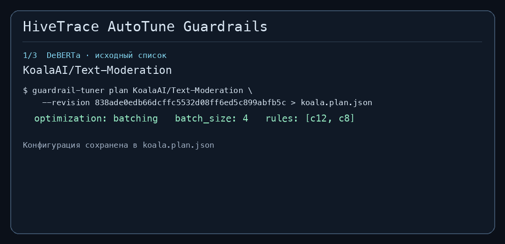

# HiveTrace AutoTune Guardrails

Общий CLI для выбора конфигурации, измерения эффекта и запуска guardrail-моделей.

**[Запуск plan → eval → report](docs/u1_handoff.md#общий-cli-plan--eval--report)** ·
[протокол измерений](docs/measurement_protocol_v1.md) ·
[полные конфиги моделей](configs/v4) ·
[остальные команды CLI](docs/cli-guide.md) · [разработка](CONTRIBUTING.md)


## Основной сценарий

Из клона репозитория, после подготовки отдельных сред и данных по инструкции:

```bash
uv run --locked --no-sync guardrail-tuner plan --config configs/v4/protectai.json --output protectai-plan.json
uv run --locked --no-sync guardrail-tuner eval --config protectai-plan.json --output runs/protectai-eval
uv run --locked --no-sync guardrail-tuner report runs/protectai-eval
```

`plan` предлагает один полный кандидат по правилам команды, без весов и GPU.
`eval` использует измеритель У1: baseline один раз, затем candidate; с
`--baseline-ref` исполняется только candidate. Confirm необязателен.
Предложение конфигурации не означает доказанное ускорение.

```bash
uv run --locked --no-sync guardrail-tuner run --config protectai-plan.json --text "The meeting starts at noon."
uv run --locked --no-sync guardrail-tuner serve --config protectai-plan.json
```

`run/serve` исполняют выбранный вариант через тот же нативный адаптер.
`--variant baseline` выбирает исходную модель. Разметка качества подключается
отдельно; отсутствие flips не означает сохранённое safety-качество.

## Измерения и совместимость

- ProtectAI: HF sequence classifier; AccuKnox: нативный D3 probabilities/readout, не vLLM/generate.
- Среды моделей: Linux/Python 3.13, закреплённые `team-rtx` и `team-d3`. Основной CLI не меняет их зависимости.
- Модельные бакеты и батчи задаются JSON-конфигом. Память собирается со скоростью; основные метрики p95/p50 полного батча.
- Конфиги измерителя — schema 4, новые результаты — версия 5. Полный baseline v4 читается без миграции с проверкой совместимости.
- Новый CLI-план имеет `plan_version=2`; это не изменение версии протокола измерений.
- Старые команды `benchmark/optimize/tune-model` сохраняются, но их прежний p99-протокол не является приёмкой У1.
- `optimize` сохраняет исполняемый артефакт для `run/serve`, включая ONNX external data и контрольные суммы.
- Новые У1-команды требуют checkout. Старые самостоятельные команды остаются доступны из wheel.

[Полные baseline ProtectAI и AccuKnox](results/u1_handoff/2026-11-26-new-families-baseline/README.md):
10/10 ячеек комплектны на RTX 5090. Эти результаты не подтверждают новые правила
общего CLI. [Новый полный eval](results/u1_handoff/2026-11-26-cli-eval/README.md):
ProtectAI прошёл обе ячейки, AccuKnox ещё измеряется; `run/serve` GPU-проверка
не завершена. Актуальный статус интеграции указан в операционной инструкции.

## Исторические результаты

[Карта документов](docs/README.md) · [статусы проверок У1](docs/u1_handoff_readiness.md) ·
[HaloGuard: профилирование](results/profiling/HaloGuard1-Gen-0.8B/README.md) ·
[GLiNER: профилирование](results/profiling/GLiNER-Guard-Omni/README.md) ·
[GLiNER ONNX/compile](results/comparison/gliner/REPORT.md) ·
[T4 screening измерителя](docs/benchmark.md)
## Дополнительные проверки

| Команда | Назначение |
| --- | --- |
| `inspect`, `datasets` | Прочитать конфиг модели и проверить источники данных |
| `benchmark`, `optimize` | Сравнить PyTorch и ONNX Runtime для классификации |
| `tune-model`, `check-generation`, `compare-app` | Проверить компиляцию, кэш генерации или прикладные выходы |

Исторические исходники, артефакты и approvals сохраняются. Их проценты ускорения
не переносятся на новые модели, среды, данные или конфигурации.
